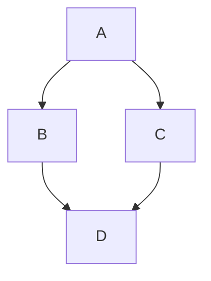

# VSCode
## Shortcuts

1. <kbd> alt+↑ </kbd> mover líneas
2. <kbd> alt+shift+↑ </kbd> copiar líneas
3. <kbd> cntrl+shift+k </kbd> borrar líneas
4. <kbd> ctrl+alt+↑ </kbd> voltear pantalla
5. <kbd> alt+click </kbd> multiples curosres

**negritas**
_italicas_
<u>subrayado</u>
~~tachado~~

Uso de listas
- 1
- 2
- 3 
    - 4

- [ ] tarea 
- [X] tarea 
 
1. 
2. item
    1.
    2.
3. l

$$
    E_{i} = \frac{2}{x} * \sum_{i=0}^{n}{i}
$$

codigo embebido
```python
def test():
print("hola")
```

```javascript
let a=[1,2,3]
console.log(a);
``` 





